  
  
  
  

## Sobre

Sou **Engenheiro de QA Sênior** na **NEOS Tecnologia**, onde lidero a equipe de automação de testes com Cypress. Crio e implemento estratégias de teste para que produtos complexos cheguem à produção com qualidade.

Atuo com testes manuais e automatizados em aplicações web, APIs, back-end e mobile, sempre integrados a pipelines de CI/CD. Antes, passei pela Elevor, pela Spread Tecnologia e pela Compass UOL.

## Stack

  
   
  

| Área | Ferramentas |
| --- | --- |
| Automação de testes | Cypress · Playwright · Selenium · WebDriver · Appium · SpecFlow · Cucumber · JUnit · TestNG · REST Assured · Postman · SoapUI |
| Linguagens e dados | C# · Java · JavaScript · TypeScript · Python · Ruby · SQL · Oracle DB |
| DevOps e CI/CD | Jenkins · Azure DevOps · GitHub Actions · GitLab CI · Git · Docker · AWS · Azure |
| Práticas | Ágil/Scrum · Kanban · BDD · TDD · Page Object Model · Shift-Left Testing · Jira |

## Experiência

## Contribuições

<picture>
  <source media="(prefers-color-scheme: dark)" srcset="https://raw.githubusercontent.com/ypek/ypek/output/github-snake-dark.svg">
  
</picture>

Mais sobre mim em <a href="https://ypek.github.io/">ypek.github.io</a> · Passo Fundo, RS — Brasil

